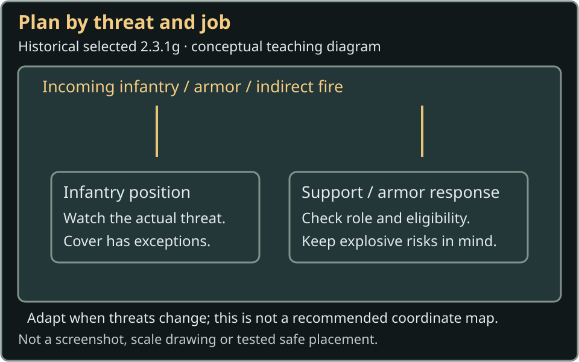

# Mud and Blood 2: player reference

Build a squad, hold the line and adapt as enemy waves bring new threats.
Spend **tactical points (TP)** on recruits, weapons, defenses and support;
deciding what you can afford next is part of the battle.

**Historical reference: selected Mud and Blood 2, 2.3.1g.**
[Choose the matching edition and play route](editions.md).
Modern simulation rules and dated experiments have a [separate route below](#modern-combat-measurements-and-lifecycle-questions).

| What would you like to do?      | Start here                                                                                                                                                              |
| ------------------------------- | ----------------------------------------------------------------------------------------------------------------------------------------------------------------------- |
| **Learn your first deployment** | [Start here](starting-checklist.md): inspect, move, buy, respond and read results                                                                                       |
| **Solve a problem now**         | [Soldier won't move](controls.md#why-is-a-selected-soldier-not-moving) · [Won't shoot](why-soldiers-stop-shooting.md) · [Mechanics questions](mechanics-at-a-glance.md) |
| **Plan a purchase or explore**  | [Recruit plus job budgets](purchase-budgets.md) · [Weapon comparison](weapon-comparison.md) · [Browse all topics](topic-index.md)                                       |

[Open full-size diagram: battlefield overview](media/battlefield-overview-b40ca5cd43fba3ceba66f83f9060e443dc82490679fc37cce713737c05797af1.svg)

[Read the battlefield and interface guide](instructional-visuals.md).
This original diagram explains decisions; it does not certify safe positions or historical timing.

## Start with a player question

- **What should I buy for this threat?** Compare [recruits](recruitment.md),
  [anti-tank options](anti-tank-options.md) and [protection](defenses.md).
- **Why did that order fail?** Check [controls](controls.md),
  [equipment application](training-and-equipment.md) or [radio requests](support.md).
- **What changed my points or progress?** Check [TP income](tactical-points.md),
  [soldier versus career progress](progression.md) and [mission results](score-and-career-points.md).

[More questions with direct answers](topic-index.md#start-with-a-player-question).

## Featured decisions

**Mechanic: a marker is an order, not arrival.** If a soldier is selected but
stays still, [check movement before issuing more orders](controls.md#why-is-a-selected-soldier-not-moving).

**Tactical case: buy the whole job.** An Engineer plus one sandbag wall has a
normal paid budget of **5 TP**, not 1 TP. [Compare construction commitments](purchase-budgets.md#building-one-position-from-scratch),
then [check which protection your specialist can use](specialists-under-cover.md).

**Progression goal: unlock a different starting problem.** Career rank, rather
than a soldier's XP, controls the named deployment entries.
[Compare deployment requirements](deployments.md#compare-entry-rank-and-starting-resources)
before planning a [medal or rank](career-medals-and-ranks.md).

[What's new and corrected](whats-new.md) keeps player-facing changes and their edition together.

## Recruits, vehicles and placed weapons

[Choose a recruit](recruitment.md), [compare anti-tank support](anti-tank-options.md)
or [browse infantry, vehicles and placed guns](topic-index.md#recruits-vehicles-and-placed-weapons).

## Defenses, concealment and collateral damage

[Compare protection](defenses.md), [understand concealment](concealment.md) or
[browse defenses and friendly-fire hazards](topic-index.md#defenses-concealment-and-collateral-damage).

## Weapons and firing

[Compare weapons](weapon-comparison.md), [find out why a soldier stopped firing](why-soldiers-stop-shooting.md)
or [browse weapons and explosive equipment](topic-index.md#weapons-and-firing).

## Radio support and economy

[Plan a radio request](support.md), [budget recruits and calls](purchase-budgets.md)
or [browse support and economy](topic-index.md#radio-support-and-economy).

## Waves, enemies and career progress

[Recognize enemy roles](enemy-guide.md), [plan career progress](progression.md)
or [browse waves, threats and rewards](topic-index.md#waves-enemies-and-career-progress).

## Commands, field actions and older strategies

[Learn controls](controls.md), [check orders](orders.md) or
[browse field actions and historical strategy context](topic-index.md#commands-field-actions-and-older-strategies).

## Version and evidence boundaries

Same-label historical binaries can contain different rules. [Edition identity](editions.md)
explains which reference this wiki uses and separates source facts, community
advice and modern measurements. Article warnings stay beside the claims they qualify.

Detailed research bindings and editorial acceptance history are retained in the
repository; they are not required to follow the player routes above.

## Modern combat measurements and lifecycle questions

Modern simulation pages describe their own rules or dated studies; they do not
supply original Flash rates. [Check the edition before using them](editions.md).

- [Combat choices measured November 7, 2026](combat-results.md): stationary,
  unopposed comparisons of the tested builds and loadouts.
- [Modern rifle skill and effective caps](rifle-skill.md): weapon-specific
  accuracy arithmetic, with Remaster and Community exceptions.
- [Infantry lifecycle](unit-lifecycle.md): source stages and dated modern observations.
- [Combat findings and later corrections](combat-issues.md): archived failures
  and the scope of follow-up corrections.
- [Hand and rifle grenade output](grenades.md#measured-grenade-output-in-the-modern-simulation):
  launches measured separately from damage and kills.

Later corrections do not retroactively update the archived measurements.
