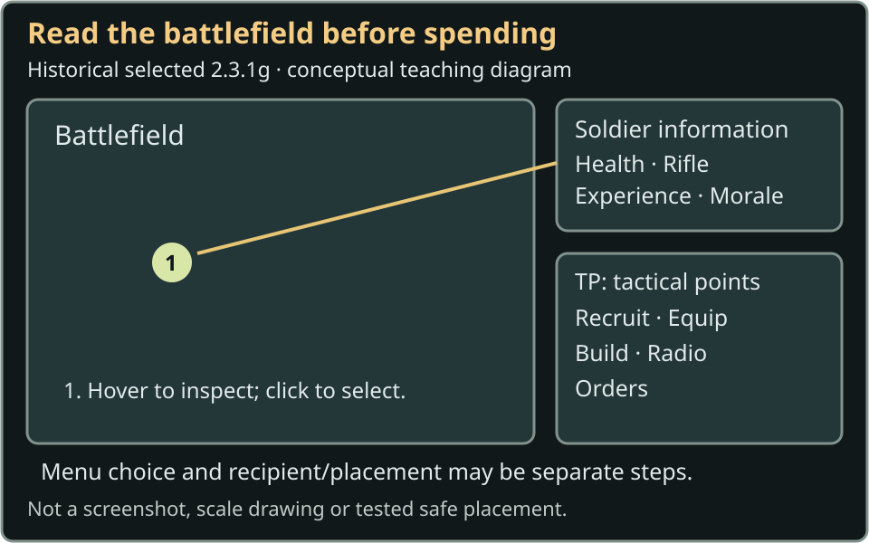
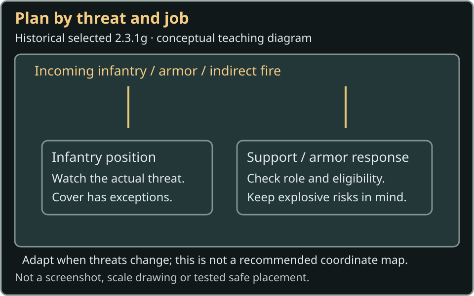
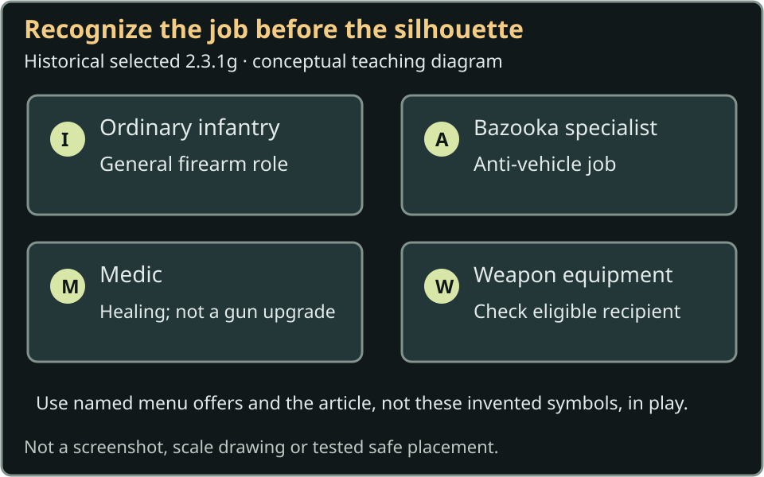
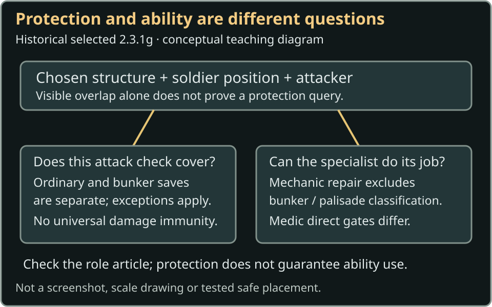
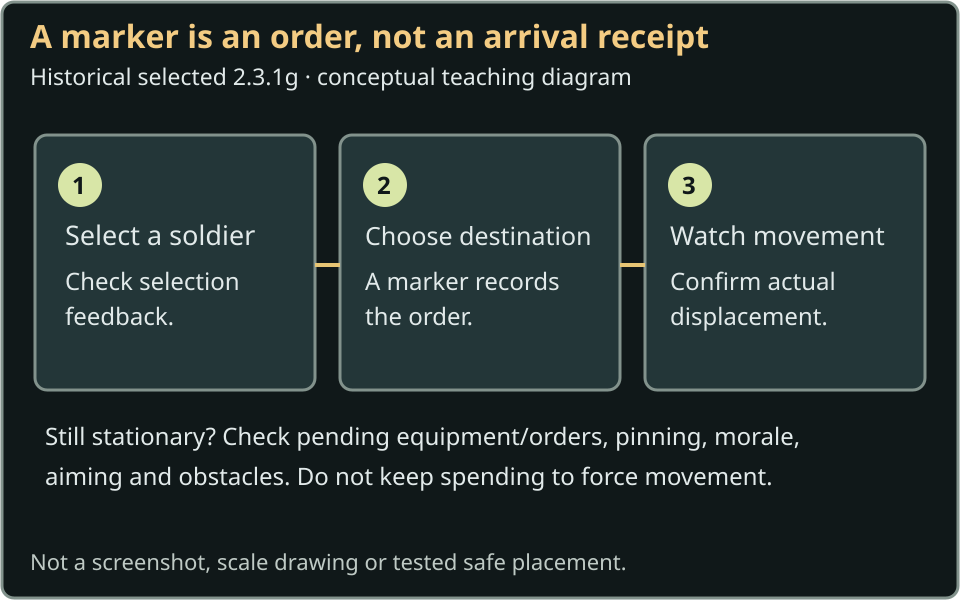

# A visual guide to the first decisions

These original diagrams teach **historical selected 2.3.1g** concepts. They are
not screenshots, historical unit icons, measured geometry or evidence of a
successful opening. Labels explain the idea without requiring you to recognize
the invented symbols. Open an image in its own tab to inspect the full diagram.

## Read the interface

[Open full-size diagram: interface guide](media/interface-guide-822e43df39ebfcd35bf1b881876091f4b846e1dfbc65a9f8b206037e9a39f983.svg)

Read health, rifle, experience and morale as different fields. TP means tactical
points. Choosing a menu offer can leave a separate recipient or placement step.
Compare the [controls guide](controls.md) and [menu labels](menu-reference.md).
The arrangement above is a teaching layout, not a reproduction of a host UI.

## Read the battlefield

[Open full-size diagram: battlefield overview](media/battlefield-overview-b40ca5cd43fba3ceba66f83f9060e443dc82490679fc37cce713737c05797af1.svg)

Identify what threatens the squad before buying protection. A defense useful
against ordinary bullets does not establish protection against every enemy,
explosion or flame. Use [defenses](defenses.md), [anti-tank options](anti-tank-options.md)
and [versioned strategy studies](strategy-studies.md) for the decisions behind
the diagram. Positions here are conceptual roles, not a safe-placement recipe.

## Recognize roles and equipment

[Open full-size diagram: recognition guide](media/recognition-guide-970b5f1ab2838ddd4ea18bb2f53baf2c280a3fec24ff1e1aa24b4892a784d88b.svg)

A recruit's job and its equipment are different purchases. Read the actual
menu name and recipient eligibility; these symbols are teaching aids only.
[Recruitment](recruitment.md) compares jobs, and [purchase budgets](purchase-budgets.md)
includes the recruit plus its later work. Historical art and sound files remain
excluded because local preservation does not establish distribution permission.

## Check protection and specialist ability separately

[Open full-size diagram: cover specialists](media/cover-specialists-4d608109f03f5478e37ddf3aec886063a8885617411a503c60ac2b4d4ba0dcd1.svg)

Actual classification depends on the structure, soldier, caller and state.
Visible overlap alone does not prove protection. A role's other health, timing
and recipient conditions still apply. Read [specialists under cover](specialists-under-cover.md)
before placing a role for its ability.

## Diagnose an order that did not move the unit

[Open full-size diagram: failed order](media/failed-order-6b1ae26027154220480776cbace43d77229350e235e7ac40c0c8fb0db84f2aaf.svg)

A destination marker records an order, not arrival. If the soldier stays still,
check the [selected-but-not-moving route](controls.md#why-is-a-selected-soldier-not-moving)
before spending more. The diagram is not timing evidence or a guarantee that
changing one state immediately restarts movement.

## Credits and scope

All five diagrams are original project-authored vector drawings created
November 11, 2026. They contain no imported game art. Only the exact committed
files, hashes, SVG type and bounded inert drawing vocabulary are admitted by
the media manifest. No remote image fetch, upload or arbitrary file browser is
provided. [Editions](editions.md) and [evidence scope](evidence-and-method.md)
explain the rules and observation limits.

[Player home](README.md) · [Beginner route](starting-checklist.md)
