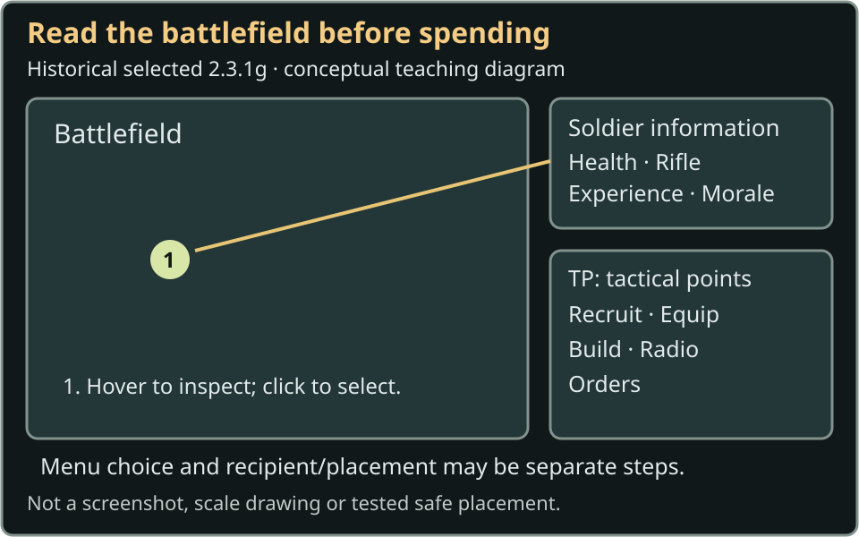
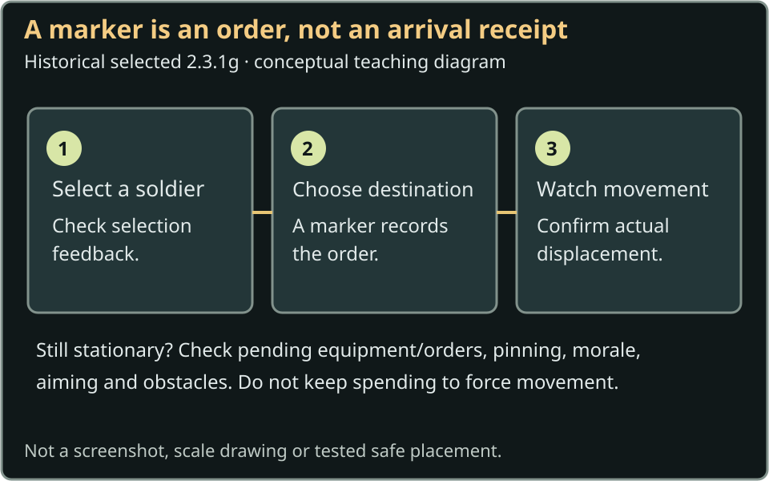

[Player reference](README.md) · [Editions and play routes](editions.md)

# Starting checklist

Your first task is to keep a usable squad fighting while stopping enemies from
getting through your line. Learn one action at a time: inspect a soldier, move,
spend TP, then respond to what appears. Losing usable soldiers and missed-enemy
loss checks are separate risks; [the breakthrough warning is not a safe allowance of nine visible enemies](breakthroughs.md).

This route describes **historical selected 2.3.1g**. Start from the
[matching edition route](editions.md); the generic modern game is a separate ruleset.
Use ordinary default deployment for this exercise and inspect what actually
arrives. The selected initialization requests four Regular Soldiers and starts
from 0 base TP before career additions; this does not promise the final displayed
balance. [Starting-mode details](deployments.md).

Follow the steps below, with the [interface and battlefield diagrams](instructional-visuals.md)
beside them. Then use the [costed practice opening](beginner-opening.md).
That short original-game exercise now records movement, a paid Garand choice and deliberate mission ending; it is not a survival recommendation.

## Check the starting conditions

[Open full-size diagram: interface guide](media/interface-guide-822e43df39ebfcd35bf1b881876091f4b846e1dfbc65a9f8b206037e9a39f983.svg)

Original teaching diagram, not an observed screenshot. Match labels to the
edition you actually launched.

**Do:** identify the edition, default deployment, displayed TP and actual squad.
Hover over one ordinary soldier. Read **health**, **rifle skill**, **experience
(XP)** and **morale** as different stats.

**Look for:** the soldier's information panel. Starting equipment and stats can
change with career awards, so inspect before buying a replacement.

**If it differs:** use the squad and balance you see; do not copy a purchase
order that assumes free gifts or a different mode. [Reading stats](reading-stats.md),
[deployment gifts](deployment-gifts.md).

## Select, inspect and move one unit

**Do:** click an ordinary soldier, then a nearby destination on clear ground.
Move one unit first so you can see which one received the order.

**Look for:** selection feedback, a destination marker and then actual travel.
Hovering to inspect is different from selecting to move.

**If the marker appears but nothing moves:** stop adding orders and use
[selected-but-not-moving checks](controls.md#why-is-a-selected-soldier-not-moving).
Pinning, aiming, low morale, obstacles or an unfinished equipment choice can
interfere. Use the [mouse instructions](controls.md) before relying on
[legacy keyboard shortcuts](controls.md#keyboard-instructions-are-legacy-guidance).

[Open full-size diagram: failed order](media/failed-order-6b1ae26027154220480776cbace43d77229350e235e7ac40c0c8fb0db84f2aaf.svg)

The marker shows an order, not certified movement or timing.

## Budget in tactical points

**TP means tactical points:** the balance pays for recruits, equipment,
construction and support. **Do:** choose one affordable job and count its whole
cost. A new Regular Soldier plus a Garand costs a normal paid **3 + 2 = 5 TP**;
an already eligible soldier only needs the 2-TP upgrade.

**Look for:** enough displayed TP for the offer, and the intended unit's current
weapon. The default mode's base TP is 0, so this exercise need not begin with a purchase.

**If you cannot afford it:** wait for actual income or choose a cheaper job.
Expected future TP is not money already available. [Possible income](tactical-points.md#where-can-more-tp-come-from),
[full purchase budgets](purchase-budgets.md). Soldier XP and career points are
[different kinds of progress](progression.md).

## Distinguish buying, applying and receiving

**Do:** when you have at least **2 TP** and an eligible ordinary soldier who
does not already have a Garand, select the Garand equipment offer, then click
that soldier. Finish this one choice before selecting another.

**Look for:** the recipient's weapon changing. A paid menu choice can still need
its recipient click; a marker or changed balance alone does not prove the unit
received the weapon.

**If it fails:** inspect the selected unit and any earlier pending choice. This
ordinary equipment path requires more than 9 health. Do not keep rebuying:
duplicate equipment and refunds have their own rules.
[Equipment steps](training-and-equipment.md), [Garand](m1-garand.md),
[duplicate-credit limits](free-orders-and-refunds.md).

Recruiting is another useful next exercise: a Regular Soldier has a **3-TP**
base offer. Check arrival and health rather than treating the menu click as a
finished recruit. [Recruitment](recruitment.md).

## Match protection and response to the threat

**Do:** identify what is hurting the squad before spending. As tactical judgment,
avoid placing everyone together and avoid moving the whole line at once; this
is not a tested spacing or safe-position rule.

| What you see                     | Response to learn                                            | What to check afterwards                                                  |
| -------------------------------- | ------------------------------------------------------------ | ------------------------------------------------------------------------- |
| Infantry firing on the line      | Compare [bullet protection](defenses.md)                     | The unit still performs its job; some cover restricts specialists         |
| A soldier not firing             | Use the [nonfiring checklist](why-soldiers-stop-shooting.md) | Health, pinning, orders and eligible targets before buying another weapon |
| A vehicle surviving rifle fire   | Compare [anti-tank options](anti-tank-options.md)            | Hull and crew damage differ; a rocket nearby is not a confirmed kill      |
| Your explosives threaten friends | Check [collateral damage](collateral-damage.md)              | Backblast, blast and flame do not share one safe-distance rule            |
| Enemies reaching the lower edge  | Check [breakthroughs](breakthroughs.md)                      | The warning is a shared counter with differing contributions              |

**If protection seems to stop a specialist:** read
[specialists under cover](specialists-under-cover.md) before buying more of the same defense.
The [conceptual diagrams](instructional-visuals.md) explain these distinctions;
they are not certified placement geometry.

## Know which action ends what

**Do:** continue until a natural mission end, or deliberately choose Retreat to
Main Menu when ready to stop. Treat that menu action as immediate: the inspected
script has no confirmation check. Withdrawing one unit and advancing the squad
have different consequences. [Ending actions](withdrawal-and-mission-end.md).

**Look for:** the end-of-mission/results display. Read mission score, career
points, soldier XP and leftover TP separately. [Results explained](score-and-career-points.md).

**If an expected award does not appear:** check its actual counter and award
processing before assuming progress was lost. A result display alone does not
prove a durable save. [Medals and ranks](career-medals-and-ranks.md).

Next, [repeat a small practice budget](beginner-opening.md),
[compare recruits for a particular job](recruitment.md), or
[solve the problem you saw](mechanics-at-a-glance.md). Change one decision at a
time so you can tell what happened.

Evidence and remaining walkthrough limits

This learning sequence combines the linked selected-2.3.1g explanations with
the November 11 worked opening: fresh local profile, selection/movement, paid
Garand offer and recipient interaction, then deliberate menu retreat to results.
The [worked opening](beginner-opening.md) states the actual display, failed
attempts and limits. No natural-survival, timing, durable-save or every-device
qualification follows from that one bounded exercise.

Original detailed bindings remain in the repository: movement input,
recruitment, equipment/control observations, defense queries, support, mission
ending and result accounting. The original checklist source identities are
retained in `player-notes/starting-checklist.md`.

